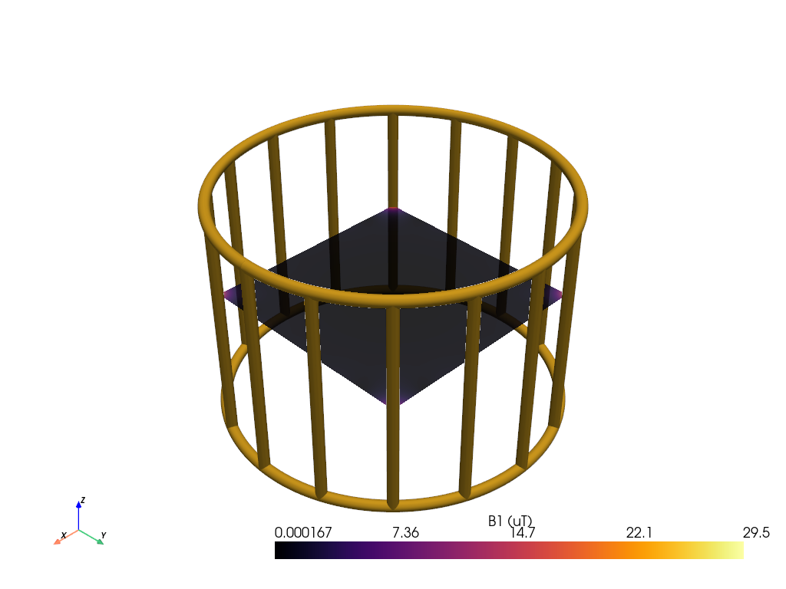

# Birdcage RF Coil Simulator

Simulação 3D interativa de uma bobina de RF tipo birdcage, a bobina que gera e capta o campo magnético em um aparelho de ressonância magnética.

## Para quem é
Estudantes, pesquisadores e engenheiros que querem entender e explorar o projeto de bobinas de RF de forma rápida e visual.

## O que faz
- **Geometria configurável**: número de pernas, tamanho da bobina, intensidade do campo e tipo de montagem dos capacitores.
- **Comportamento ressonante**: mostra as frequências de ressonância e o valor de capacitor necessário para sintonizar o modo de imagem.
- **Mapa do campo magnético** em um corte da bobina.
- **Métricas de homogeneidade** usadas no controle de qualidade de bobinas reais.
- **Painel interativo** para comparar configurações na hora.
- Ferramenta de estudo e exploração, não de uso clínico.

## Telas

---

Este repositório é uma **vitrine** do projeto: mostra o que o sistema faz e como ele é. O código-fonte não é público.

Desenvolvido por [@won3er](https://github.com/won3er).